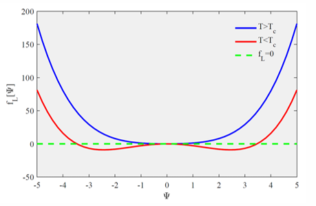
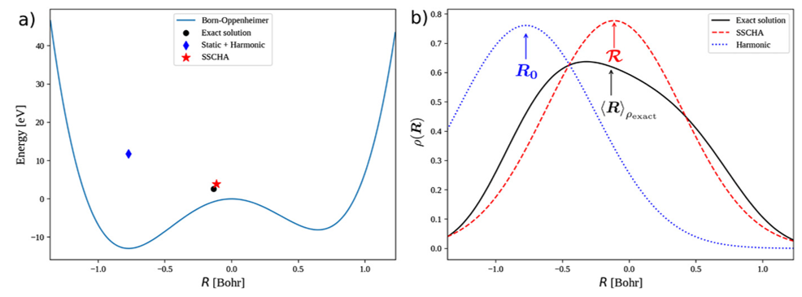

# Phonon Anharmonicity and Stochastic Self-Consistent Harmonic Approximation (SSCHA)

本章將介紹簡諧近似的物理意義、非諧聲子效應、自由能與結構相變，以及如何使用隨機自洽諧和近似方法研究非諧晶格振動。

This chapter explains the harmonic approximation, phonon anharmonicity, free energy, structural phase transitions, and the SSCHA method.

---

# 1. Harmonic Approximation（簡諧近似）

## 1.1 Physical Picture（物理圖像）

在晶體中，原子會在平衡位置附近振動。如果原子的位移很小，我們可以將原子的勢能近似為一個拋物線形狀的諧和勢。

In a crystal, atoms vibrate around their equilibrium positions. If the atomic displacement is small, we can describe the potential energy using a harmonic potential.

假設原子的平衡位置為 $R_0$，原子的位置為 $r$，則原子的位移可以表示為：

Let $R_0$ be the equilibrium position and $r$ be the atomic position. The displacement is:

$$
u=r-R_0
$$

將原子的勢能 $V(r)$ 在平衡位置附近進行泰勒展開：

We can use a Taylor expansion to describe the potential energy near the equilibrium position:

$$
V(R_0+u)
=
V(R_0)
+
\left.\frac{\partial V}{\partial r}\right|_{R_0}u
+
\frac{1}{2}
\left.\frac{\partial^2 V}{\partial r^2}\right|_{R_0}u^2
+
\frac{1}{3!}
\left.\frac{\partial^3 V}{\partial r^3}\right|_{R_0}u^3
+\cdots
$$

由於原子位於平衡位置時，受到的淨作用力為零，因此勢能的一階導數為零：

At the equilibrium position, the total force on the atom is zero. Therefore, the first derivative of the potential energy is zero:

$$
\left.\frac{\partial V}{\partial r}\right|_{R_0}=0
$$

如果忽略三階及更高階的項，並將平衡位置的勢能設為零，就得到簡諧近似：

If we ignore the third-order and higher-order terms, and set the energy at equilibrium to zero, we obtain the harmonic approximation:

$$
\boxed{
V(u)\approx\frac{1}{2}Cu^2
}
$$

其中 $C$ 為諧和力常數，描述原子偏離平衡位置時，勢能增加的程度。

Here, $C$ is the harmonic force constant. It describes how fast the potential energy increases when the atom moves away from equilibrium.

$$
C=
\left.\frac{\partial^2 V}{\partial r^2}\right|_{R_0}
$$

## 1.2 Limitations of the Harmonic Approximation（簡諧近似的限制）

簡諧近似只保留勢能的二階項，因此原子振動可以用諧和振子來描述。

The harmonic approximation only keeps the second-order term. Therefore, atomic vibrations are described by harmonic oscillators.

在這個模型中，聲子的頻率由二階力常數決定。如果晶體結構固定，而且不考慮其他相互作用，聲子頻率不會因為振動振幅增加而改變。

In this model, phonon frequencies depend on the second-order force constants. For a fixed crystal structure, the frequencies do not change with vibration amplitude.

然而，真實材料中的原子振動不一定很小，因此高階勢能項可能變得重要。

However, atomic vibrations in real materials are not always small. Higher-order terms can become important.

---

# 2. Phonon Anharmonicity（聲子非諧效應）

## 2.1 What Is Anharmonicity?（什麼是非諧效應？）

當原子振動的位移較大時，原子的勢能不再能夠只用二次函數描述，必須考慮三階、四階或更高階的勢能項。

When atomic vibrations become large, the potential energy cannot be described by only a quadratic function. We need to include third-order, fourth-order, and higher-order terms.

$$
\boxed{
V(u)
=
\frac{1}{2}Cu^2
+
\frac{1}{3!}\Phi^{(3)}u^3
+
\frac{1}{4!}\Phi^{(4)}u^4
+\cdots
}
$$

其中，$\Phi^{(3)}$ 和 $\Phi^{(4)}$ 分別表示三階與四階非諧力常數。

Here, $\Phi^{(3)}$ and $\Phi^{(4)}$ are the third-order and fourth-order anharmonic force constants.

這些高階項會改變原子的振動行為，因此真實的晶格振動可能與簡諧模型的預測不同。

These higher-order terms change atomic vibrations. Therefore, real lattice vibrations can be different from the harmonic model.

## 2.2 Physical Effects of Anharmonicity（非諧效應的物理影響）

在簡諧近似中，聲子之間沒有由高階勢能項產生的相互作用，因此理想諧和聲子不會因聲子－聲子散射而具有有限壽命。

In the harmonic approximation, there are no phonon–phonon interactions from higher-order potential terms. Therefore, ideal harmonic phonons have no finite lifetime caused by phonon–phonon scattering.

當非諧效應存在時，聲子之間可以發生散射，使聲子具有有限壽命，並可能改變其頻率。

With anharmonicity, phonons can scatter with each other. This can give phonons a finite lifetime and change their frequencies.

此外，非諧效應也可能影響晶格熱膨脹、熱傳導、結構穩定性與相變行為。

Anharmonicity can also affect thermal expansion, heat transport, structural stability, and phase transitions.

因此，當非諧效應很強時，單純使用簡諧近似可能無法準確描述材料的聲子性質。

Therefore, when anharmonicity is strong, the harmonic approximation may not describe phonon properties accurately.

這也是為什麼我們需要引入能夠處理非諧晶格振動的方法，例如隨機自洽諧和近似方法。

This is why we need methods that can describe anharmonic lattice vibrations, such as SSCHA.

---

# 3. Landau Theory and Second-Order Phase Transition（朗道理論與二階相變）

## 3.1 Order Parameter（序參量）

在研究結構相變時，我們可以使用序參量 $\eta$ 描述系統的有序程度。

We can use an order parameter $\eta$ to describe the ordered state of a system.

在高溫的無序相中，序參量通常為零；當系統進入低溫有序相時，序參量可以變成非零。

In the high-temperature disordered phase, the order parameter is usually zero. In the low-temperature ordered phase, it can become nonzero.

## 3.2 Free Energy Expansion（自由能展開）

根據朗道理論，我們可以將系統的自由能表示為序參量的函數。

In Landau theory, we can write the free energy as a function of the order parameter.

對於具有 $\eta\rightarrow-\eta$ 對稱性的系統，自由能只能包含序參量的偶數次方：

For a system with symmetry under $\eta\rightarrow-\eta$, the free energy contains only even powers of the order parameter:

$$
\boxed{
F(\eta)
=
F_0+\frac{r}{2}\eta^2+\frac{u}{4}\eta^4+\cdots
}
$$

其中 $r$ 與溫度有關，而 $u>0$ 用來確保系統在這個模型中的穩定性。

Here, $r$ depends on temperature, and $u>0$ keeps the system stable in this model.

為了找出系統最穩定的狀態，我們需要尋找自由能的最小值：

To find the most stable state, we need to find the minimum of the free energy:

$$
\frac{\partial F}{\partial\eta}=0
$$

因此：

Therefore:

$$
r\eta+u\eta^3=0
$$

$$
\boxed{
\eta(r+u\eta^2)=0
}
$$

可以得到：

We obtain:

$$
\eta=0
$$

或：

Or:

$$
\eta=\pm\sqrt{-\frac{r}{u}}
\qquad(r<0)
$$

## 3.3 Temperature and Phase Transition（溫度與相變）

假設：

Assume:

$$
r=a(T-T_c),\qquad a>0
$$

當 $T>T_c$ 時，$r>0$，系統的自由能最小值位於 $\eta=0$，因此系統處於無序相。

When $T>T_c$, $r>0$. The free energy is lowest at $\eta=0$, so the system is in the disordered phase.

當 $T<T_c$ 時，$r<0$，系統的自由能最小值移動到兩個非零序參量的位置，因此系統可以形成有序相。

When $T<T_c$, $r<0$). The free energy has two minima at nonzero order parameters, so the system can enter an ordered phase.

在這個簡化模型中，序參量會隨溫度連續變化，並在臨界溫度趨近零，因此可以描述連續的二階相變。

In this simple model, the order parameter changes continuously with temperature. It approaches zero at the critical temperature, describing a continuous second-order phase transition.

當系統選擇其中一個非零序參量時，原本的對稱性可能被破壞，這稱為自發對稱破缺。

When the system chooses one of the nonzero order parameters, the original symmetry can be broken. This is called spontaneous symmetry breaking.

朗道理論可以幫助我們理解自由能、結構穩定性與相變之間的關係。接下來，我們將使用自由能的概念介紹隨機自洽諧和近似方法。

Landau theory helps us understand the relation between free energy, structural stability, and phase transitions. Next, we use the idea of free energy to introduce SSCHA.

---

# 4. Stochastic Self-Consistent Harmonic Approximation (SSCHA)

## 4.1 Why Do We Need SSCHA?（為什麼需要隨機自洽諧和近似？）

在簡諧近似中，我們只使用勢能的二階導數來描述晶格振動，但真實材料可能存在強烈的非諧效應。

In the harmonic approximation, we use only the second derivative of the potential energy. However, real materials can have strong anharmonic effects.

為了考慮這些效應，隨機自洽諧和近似方法使用一個可以調整的試探諧和系統，來近似真實的非諧系統。

SSCHA uses an adjustable trial harmonic system to describe a real anharmonic system.

這個方法的主要目標，是透過自由能最小化找到較合適的原子平均位置與有效力常數。

The main goal is to minimize the free energy and find better average atomic positions and effective force constants.

## 4.2 Free Energy and Density Matrix（自由能與密度矩陣）

在統計力學中，系統的亥姆霍茲自由能可以寫成：

In statistical mechanics, the Helmholtz free energy is:

$$
\boxed{
F=E-TS
}
$$

其中 $E$ 為內能、$T$ 為溫度、$S$ 為熵。

Here, $E$ is the internal energy, $T$ is the temperature, and $S$ is the entropy.

由於系統可能處於不同的量子態，我們可以使用密度矩陣 $\rho$ 描述系統的統計狀態。

The system can have different quantum states. We use a density matrix $\rho$ to describe these states.

自由能可以寫成密度矩陣的泛函：

We can write the free energy as a functional of the density matrix:

$$
\boxed{
F[\rho]
=
\mathrm{Tr}(\rho H)
+
k_BT\,\mathrm{Tr}(\rho\ln\rho)
}
$$

其中第一項為系統的平均能量，第二項與系統的熵有關。

The first term is the average energy. The second term is related to the entropy.

對於熱平衡系統，真實的平衡密度矩陣會使自由能取得最小值。

For a system in thermal equilibrium, the true equilibrium density matrix gives the lowest free energy.

## 4.3 Variational Principle of SSCHA（隨機自洽諧和近似的變分原理）

由於真實非諧系統的密度矩陣通常很難直接求解，我們可以使用試探諧和密度矩陣 $\widetilde{\rho}_{\mathcal R,\Phi}$ 來近似。

The density matrix of a real anharmonic system is usually difficult to calculate. Therefore, we use a trial harmonic density matrix $\widetilde{\rho}_{\mathcal R,\Phi}$.

這個試探密度矩陣由兩組主要參數決定：

The trial density matrix depends on two main parameters:

- \(\mathcal R\)：原子的平均位置。
- \(\Phi\)：試探諧和系統的有效力常數矩陣。

- \(\mathcal R\): The average atomic positions.
- \(\Phi\): The effective force-constant matrix of the trial harmonic system.

我們利用這個試探密度矩陣計算變分自由能：

We use this trial density matrix to calculate the variational free energy:

$$
\boxed{
\mathcal F[\mathcal R,\Phi]
=
\left\langle K+V\right\rangle_{\widetilde{\rho}_{\mathcal R,\Phi}}
-
T S[\widetilde{\rho}_{\mathcal R,\Phi}]
}
$$

其中 \(K\) 為原子核動能，\(V\) 為真實系統的勢能，而平均值是使用試探密度矩陣計算的。

Here, \(K\) is the nuclear kinetic energy and \(V\) is the real potential energy. The average is calculated using the trial density matrix.

根據自由能變分原理，試探自由能不會低於真實系統的平衡自由能：

From the free-energy variational principle, the trial free energy cannot be lower than the true equilibrium free energy:

$$
\boxed{
\mathcal F[\mathcal R,\Phi]\geq F_{\mathrm{exact}}
}
$$

因此，我們可以調整 \(\mathcal R\) 與 \(\Phi\)，尋找試探自由能的最小值：

Therefore, we can change \(\mathcal R\) and \(\Phi\) to find the lowest trial free energy:

$$
\boxed{
F_{\mathrm{SSCHA}}
=
\min_{\mathcal R,\Phi}
\mathcal F[\mathcal R,\Phi]
}
$$

這就是隨機自洽諧和近似方法的主要思想。

This is the main idea of SSCHA.

## 4.4 Trial Harmonic Hamiltonian（試探諧和哈密頓量）

在隨機自洽諧和近似方法中，我們使用一個試探諧和哈密頓量，描述原子在平均位置附近的振動。

In SSCHA, we use a trial harmonic Hamiltonian to describe atomic vibrations around the average positions.

$$
\boxed{
\widetilde H_{\mathcal R,\Phi}
=
K+
\frac{1}{2}
\sum_{ab}
\Phi_{ab}
(R_a-\mathcal R_a)(R_b-\mathcal R_b)
}
$$

其中 \(R_a\) 為原子座標，\(\mathcal R_a\) 為平均原子位置，\(\Phi_{ab}\) 為試探力常數矩陣。

Here, \(R_a\) is an atomic coordinate, \(\mathcal R_a\) is its average position, and \(\Phi_{ab}\) is the trial force-constant matrix.

這個試探模型可以產生原子位置的機率分布，並用來計算真實勢能在不同原子構型下的平均值。

This trial model gives a probability distribution of atomic positions. We use it to calculate the average real potential energy for different atomic structures.

## 4.5 Gaussian Distribution and Stochastic Sampling（高斯分布與隨機取樣）

由於試探系統是諧和系統，因此原子位移可以使用多維高斯機率分布描述。

Because the trial system is harmonic, atomic displacements follow a multidimensional Gaussian distribution.

隨機自洽諧和近似方法會根據這個機率分布，產生多組不同的原子構型。

SSCHA uses this probability distribution to generate many atomic configurations.

對這些原子構型，我們可以使用第一原理計算得到其總能量與原子受力。

For these atomic configurations, we can use first-principles calculations to obtain the total energy and atomic forces.

透過這些計算結果，可以估算試探自由能及其對變分參數的梯度。

From these results, we can estimate the trial free energy and its gradients.

## 4.6 Free-Energy Minimization（自由能最小化）

隨機自洽諧和近似方法會反覆更新原子的平均位置與試探力常數矩陣，使試探自由能逐漸降低。

SSCHA changes the average atomic positions and trial force constants many times to reduce the trial free energy.

當自由能及其梯度達到設定的收斂條件時，就可以得到最佳化後的試探諧和模型。

When the free energy and its gradients meet the convergence conditions, we obtain an optimized trial harmonic model.

這個模型考慮了非諧勢能對原子振動統計分布的影響，因此能夠提供比原始簡諧近似更完整的晶格振動描述。

This model includes the effects of the anharmonic potential on atomic vibrations. Therefore, it can describe lattice vibrations beyond the original harmonic approximation.

---

# 5. SSCHA Computational Workflow（隨機自洽諧和近似的計算流程）

在實際計算中，隨機自洽諧和近似方法需要結合原子構型取樣與第一原理能量、受力計算。

In real calculations, SSCHA combines atomic sampling with first-principles energy and force calculations.

**Step 1：建立初始諧和模型。**

首先使用簡諧力常數建立初始的試探諧和系統。

First, we use harmonic force constants to build an initial trial harmonic system.

**Step 2：產生原子構型。**

根據試探諧和模型的機率分布，隨機產生多組原子構型。

We use the trial harmonic model to generate many random atomic configurations.

**Step 3：計算能量與原子受力。**

對每個原子構型使用第一原理方法計算總能量與原子受力。

For each atomic configuration, we use first-principles calculations to obtain the energy and atomic forces.

**Step 4：計算自由能與梯度。**

利用這些計算結果估算試探自由能，以及自由能對變分參數的梯度。

We use these results to calculate the trial free energy and its gradients.

**Step 5：更新試探諧和模型。**

根據自由能梯度更新原子的平均位置與有效力常數矩陣。

We use the free-energy gradients to update the average atomic positions and effective force constants.

**Step 6：重複計算直到收斂。**

重複取樣、計算與更新，直到自由能最小化過程達到收斂條件。

We repeat the sampling, calculations, and updates until the free-energy minimization converges.

因此，整個計算流程可以表示為：

Therefore, the full calculation follows this process:

$$
\boxed{
\begin{gathered}
\text{Initial harmonic model}\\
\downarrow\\
\text{Generate atomic configurations}\\
\downarrow\\
\text{Calculate energies and forces}\\
\downarrow\\
\text{Calculate free energy and gradients}\\
\downarrow\\
\text{Update trial harmonic model}\\
\downarrow\\
\text{Repeat until convergence}
\end{gathered}
}
$$

完成自由能最小化後，可以利用最佳化後的試探力常數研究有效振動性質；若要嚴格判斷結構相變與晶格穩定性，還需要分析自由能對原子平均位置的曲率。

After free-energy minimization, we can use the optimized trial force constants to study effective vibrations. To study structural transitions and stability, we also need to examine the curvature of the free energy.

---

# 6. Physical Summary（物理圖像總結）

簡諧近似將原子振動視為平衡位置附近的小幅振動，因此只保留勢能的二階項。

The harmonic approximation describes small atomic vibrations and keeps only the second-order potential term.

然而，真實材料可能具有強烈的非諧效應，使聲子頻率、晶格穩定性與相變行為受到影響。

However, real materials can have strong anharmonic effects. These effects can change phonon frequencies, lattice stability, and phase transitions.

隨機自洽諧和近似方法利用試探諧和系統與自由能變分原理，透過隨機取樣和自由能最小化來描述這些非諧效應。

SSCHA uses a trial harmonic system and the free-energy variational principle. It uses random sampling and free-energy minimization to study anharmonic effects.

因此，這個方法可以幫助我們理解真實材料中的非諧晶格振動，以及它們對材料物理性質的影響。

Therefore, this method helps us understand anharmonic lattice vibrations and their effects on the physical properties of materials.
