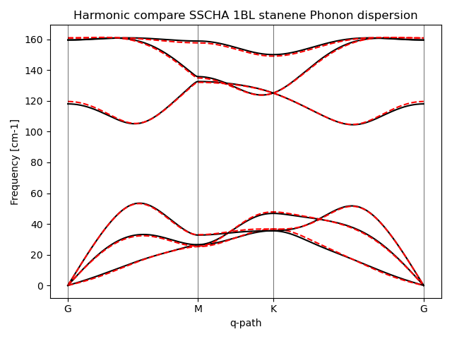
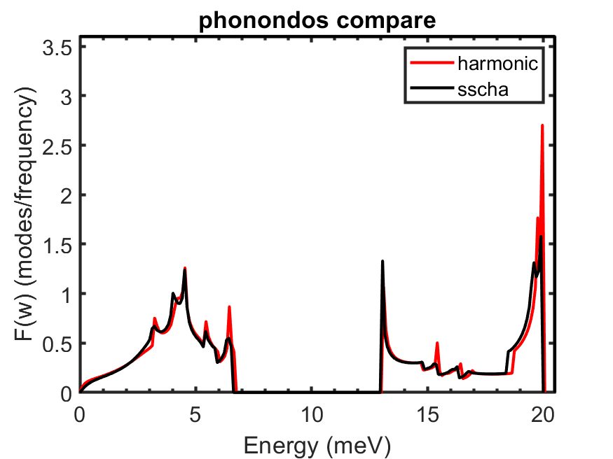
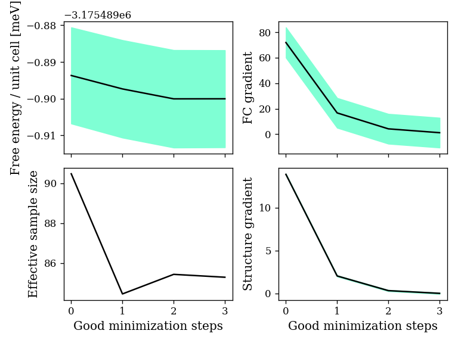
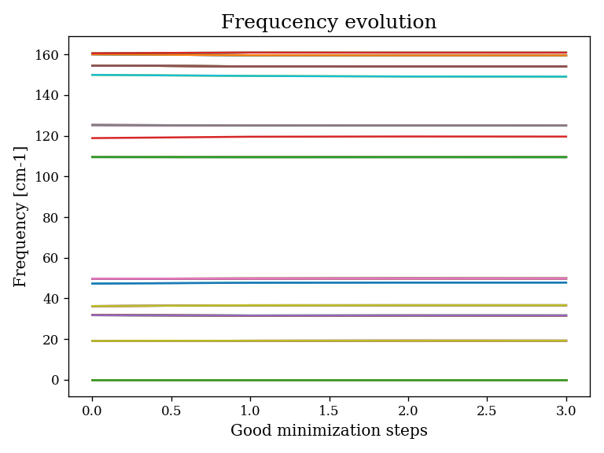

# SSCHA Tutorial: Anharmonic Electron–Phonon Coupling and Superconductivity

本教程根據原始實作筆記整理，展示如何結合密度泛函微擾理論與隨機自洽諧和近似，研究強非諧材料的電子－聲子耦合及超導性質。

This tutorial follows my original notes. It shows how to combine DFPT and SSCHA to study electron–phonon coupling and superconductivity in strongly anharmonic materials.

此實作使用經過修改的 Quantum ESPRESSO 5.1.0，將密度泛函微擾理論取得的電子－聲子矩陣元素，與隨機自洽諧和近似取得的聲子頻率和極化向量結合。

This example uses a modified Quantum ESPRESSO 5.1.0. It combines electron–phonon matrix elements from DFPT with phonon frequencies and polarization vectors from SSCHA.

最後可以計算艾利亞什伯格譜函數、電子－聲子耦合強度、超導臨界溫度，並求解各向同性米格達爾－艾利亞什伯格方程式。

Finally, we can calculate the Eliashberg spectral function, electron–phonon coupling strength, and transition temperature. We can also solve the isotropic Migdal–Eliashberg equations.

> **Note / 注意**

原始筆記明確指出，這是使用尚未充分收斂參數的 PdH 教學範例，不能把計算數值當成已驗證的材料預測。原始程式、排程腳本與特定環境路徑未在此重新執行。

The original notes say that this PdH example is not fully converged. Do not treat its numbers as verified predictions. The scripts and system paths have not been tested again here.

## 1. Example System: PdH（範例材料：氫化鈀）

範例材料是氫化鈀 PdH。鈀原子形成面心立方晶格，氫原子位於八面體間隙；本例使用岩鹽結構。

The example material is PdH. Pd atoms form an fcc lattice, and H atoms occupy octahedral sites. This example uses the rock-salt structure.

先使用密度泛函理論與密度泛函微擾理論，在 2×2×2 的聲子動量網格上取得諧和聲子資訊和電子－聲子矩陣元素。原始筆記記錄了三個不可約聲子動量點。

First, we use DFT and DFPT on a 2×2×2 phonon q-point grid. We calculate harmonic phonons and electron–phonon matrix elements. The original notes use three irreducible q-points.

不可約聲子動量點的數量可以利用修改版程式中的 `kpoints.x` 工具檢查。

The `kpoints.x` tool in the modified code can help check the number of irreducible q-points.

## 2. DFT Self-Consistent Calculation（密度泛函理論自洽計算）

第一步進行自洽場計算，取得電子基態資訊，供後續的聲子與電子－聲子耦合計算使用。

First, run an SCF calculation. It gives the electronic ground-state data needed for the phonon and electron–phonon calculations.

以下保留原始筆記中的自洽場輸入參數，包含晶格常數、擬勢、截斷能量、展寬和電子動量網格。

The input below keeps the original lattice parameter, pseudopotentials, cutoffs, smearing, and k-point grid.

```text
&control
    ! 計算類型
    calculation     =       'scf'
    ! 在輸出中顯示更多細節
    verbosity       =       'high'
    ! 計算應力張量
    tstress         =       .true.
    ! 計算原子受力
    tprnfor         =       .true.
    ! 暫存文件的前綴
    prefix          =       'pdh'
    ! 擬勢函數的存放位置
    pseudo_dir      =       './'
    ! 暫存文件的存放資料夾
    outdir          =       './tmp'
/

&system
    ! 晶胞類型
    ibrav           =       2
    ! 晶格參數 (a0, 波耳半徑)
    celldm(1)       =       7.80
    ! 原子數量
    nat             =       2
    ! 原子類型數量
    ntyp            =       2
    ! 平面波截斷能量 (Ry)
    ecutwfc         =       30.0
    ! 電荷密度截斷能量 (Ry)
    ecutrho         =       300.0
    ! 由於是金屬，所以使用展寬技術
    occupations     =       'smearing'
    ! 展寬類型
    smearing        =       'mp'
    ! 展寬參數 (Ry)
    degauss         =       0.020
/

&electrons
    ! DFT 自洽場 (SCF) 計算的混合參數
    mixing_beta     =       0.7
    ! SCF 收斂標準 (能量閾值)
    conv_thr        =       1.0d-8
/

ATOMIC_SPECIES
    Pd  106.42   Pd.pz-nd-rrkjus.UPF
    H   1.00794  H.pz-rrkjus.UPF

ATOMIC_POSITIONS {crystal}
    Pd       0.0000        0.0000        0.0000
    H        0.5000        0.5000        0.5000

K_POINTS {automatic}
    10 10 10 1 1 1
```

將輸入檔命名為 `pw.in`，並使用修改版程式執行：

Save the input as `pw.in`. Run it with the modified code:

```bash
qe-5.1.0_elph/bin/pw.x < pw.in > pw.out
```

在原始叢集環境中，也可以把兩個擬勢檔案與 `qe_ncku_elph_scf.sh` 放在同一個資料夾，再提交工作。

On the original cluster, place the two pseudopotential files and `qe_ncku_elph_scf.sh` in the same folder. Then submit the job.

```bash
qsub qe_ncku_elph_scf.sh
```

這組參數只是教程設定。實際研究必須另外測試截斷能量、電子動量網格與展寬的收斂性。

These parameters are for the tutorial only. For research, test the convergence of the cutoffs, k-point mesh, and smearing.

## 3. Harmonic DFPT Calculation（諧和聲子微擾計算）

第二步計算諧和聲子的動力學矩陣，以及電子－聲子耦合計算需要的科恩－沈勢能導數。

Next, calculate the harmonic dynamical matrix and the derivatives of the Kohn–Sham potential.

下面的原始輸入範例只選擇 2×2×2 網格中的第一個聲子動量點。其他不可約點需要相應的計算。

The input below selects only the first q-point of the 2×2×2 grid. Other irreducible q-points also need to be calculated.

```text
&inputph
    ! 暫存文件的前綴 (與 pw.x 相同)
    prefix           = 'pdh'
    ! 暫存文件的資料夾 (與 pw.x 相同)
    outdir           = './tmp/'
    ! 計算出的動力學矩陣名稱
    fildyn           = "harmonic_dyn"
    ! 第一類原子的質量 (原子質量單位)
    amass(1)         = 106.42
    ! 第二類原子的質量 (原子質量單位)
    amass(2)         = 1.00794
    ! KS 势能導數的存放文件
    fildvscf         = 'pdh_dv'
    ! 在 nq1 × nq2 × nq3 的 q 點網格上計算聲子
    ldisp            = .true.
    nq1              = 2
    nq2              = 2
    nq3              = 2
    ! 自洽計算的收斂閾值
    tr2_ph           = 1.0d-16
    ! 計算的第一個 q 點
    start_q          = 1
    ! 計算的最後一個 q 點
    last_q           = 1
&end
```

將輸入檔命名為 `ph.in`，並執行聲子程式；在原始環境中，也可提交下列排程腳本。

Save the input as `ph.in` and run the phonon program. On the original cluster, you can also submit this job script.

```bash
qe-5.1.0_elph/bin/ph.x < ph.in > ph.out
# or on the original PBS cluster:
qsub qe_ncku_elph_ph.sh
```

原始筆記表示，第一個聲子動量點的動力學矩陣會寫入 `harmonic_dyn1`。

The original notes say that the dynamical matrix for the first q-point is saved as `harmonic_dyn1`.

## 4. Electron–Phonon Matrix Elements（電子－聲子矩陣元素）

取得聲子動力學矩陣與科恩－沈勢能導數後，再使用修改版的 `ph.x`，在較密的電子動量網格上計算電子－聲子矩陣元素。

After calculating phonons and potential derivatives, use the modified `ph.x` to calculate electron–phonon matrix elements on a denser k-point grid.

這個步驟使用 `electron_phonon = 'simple'`，並設定電子能量展寬的範圍。

This step uses `electron_phonon = 'simple'` and sets the electronic smearing values.

```text
&inputph
    ! 暫存文件的前綴 (與 pw.x 相同)
    prefix           = 'pdh'
    ! 暫存文件的資料夾 (與 pw.x 相同)
    outdir           = './tmp/'
    ! 計算出的動力學矩陣名稱
    fildyn           = "harmonic_dyn"
    ! 第一類原子的質量 (原子質量單位)
    amass(1)         = 106.42
    ! 第二類原子的質量 (原子質量單位)
    amass(2)         = 1.00794
    ! KS 势能導數的存放文件
    fildvscf         = 'pdh_dv'
    ! 在 nq1 × nq2 × nq3 的 q 點網格上計算聲子
    ldisp            = .true.
    nq1              = 2
    nq2              = 2
    nq3              = 2
    ! 自洽計算的收斂閾值
    tr2_ph           = 1.0d-16
    ! 計算的第一個 q 點
    start_q          = 1
    ! 計算的最後一個 q 點
    last_q           = 1
    ! 不計算動力學矩陣
    trans            = .false.
    ! 電子-聲子相互作用類型
    electron_phonon  = 'simple'
    ! 雙重狄拉克 delta 的最小高斯展寬 (Ry)
    el_ph_sigma      = 0.004
    ! 研究的高斯展寬數量
    el_ph_nsigma     = 25
    ! 非自洽計算 (non-scf) 的 k 點網格
    nk1              = 20
    nk2              = 20
    nk3              = 20
    ! k1, k2, k3 決定是否從 Γ 點移動網格
    k1               = 1
    k2               = 1
    k3               = 1
&end
```

將輸入檔命名為 `elph.in`，並執行：

Save the input as `elph.in` and run:

```bash
qe-5.1.0_elph/bin/ph.x < elph.in > elph.out
# or on the original PBS cluster:
qsub qe_ncku_elph_elph.sh
```

修改版程式會輸出額外的電子－聲子矩陣資料，例如 `harmonic_dyn1.elph.d.mat.1`。這些資料之後會與非諧力常數結合。

The modified code writes extra electron–phonon matrix data, such as `harmonic_dyn1.elph.d.mat.1`. We will combine these data with the anharmonic force constants later.

原始筆記指出，輸出內容包含高斯展寬值、費米能階的電子態密度，以及不同展寬下的矩陣元素。

The original notes say the output includes Gaussian smearing values, the density of states at the Fermi level, and matrix elements for different smearing values.

## 5. SSCHA Sampling and Free-Energy Minimization（隨機取樣與自由能最小化）

接下來使用隨機自洽諧和近似處理非諧聲子。首先，可以使用 `plotter.py` 繪製原本的諧和聲子頻譜。

Next, use SSCHA to study anharmonic phonons. First, you can use `plotter.py` to plot the harmonic phonon spectrum.

```bash
qsub sscha_plotter.sh
# or, with the correct Python environment:
python plotter.py
```

原始案例透過 `load.py` 處理初始動力學矩陣中的虛頻，使試探諧和模型可以用於後續取樣。這是初始化用的數值處理，不代表真實結構已經穩定。

The original example uses `load.py` to handle imaginary harmonic frequencies and prepare a trial harmonic model for sampling. This is a numerical setup step. It does not prove that the real structure is stable.

```bash
qsub sscha_ncku_load.sh
# or:
python load.py
```

接著產生隨機原子構型，準備自由能最小化。

Next, generate random atomic configurations for free-energy minimization.

```bash
qsub sscha_ncku_generate_ensemble.sh
```

原始筆記記錄了 `data` 目錄，以及 `dyn_start_population1_x`、`dyn_end_population1_x` 等動力學矩陣檔案。實際輸出名稱仍需依執行腳本確認。

The original notes mention the `data` folder and dynamical-matrix files such as `dyn_start_population1_x` and `dyn_end_population1_x`. Check the actual names in your run.

使用腳本為隨機產生的原子構型建立 Quantum ESPRESSO 輸入檔，並準備輸出資料夾。

Use the script to make Quantum ESPRESSO input files for the random structures. Then prepare an output folder.

```bash
sh generate_input_files.sh
cd data/
mkdir output_espresso
cd input_files_population1/
```

原始環境使用排程腳本計算各原子構型的能量、受力與應力。提交前，必須確認擬勢路徑與輸出位置符合自己的環境。

The original cluster uses a job script to calculate energies, forces, and stresses. Check the pseudopotential paths and output folders before submitting.

```bash
qsub sscha_ncku_qe_pw.sh
```

當所有 Quantum ESPRESSO 計算完成後，回到包含 `get_energy_forces.sh` 的工作目錄，擷取輸出檔中的能量、受力和應力。

After all Quantum ESPRESSO jobs finish, return to the folder containing `get_energy_forces.sh`. Extract the energies, forces, and stresses.

```bash
cd ..
cd ..
sh get_energy_forces.sh
```

原始筆記列出的資料檔包括 `energies_supercell_population1.dat`、`forces_population1_X.dat` 和 `pressures_population1_X.dat`。

The original notes list files such as `energies_supercell_population1.dat`, `forces_population1_X.dat`, and `pressures_population1_X.dat`.

最後執行試探自由能最小化，並使用繪圖工具檢查結果。

Finally, minimize the trial free energy and use the plotting tools to inspect the result.

```bash
qsub sscha_ncku_run_min.sh
sscha-plot-data.py minim_1
python plotter_comparez_sscha.py
```

上面的指令沿用原始工作流程；其中程式、資料夾與排程腳本必須先放在正確位置。

The commands above follow the original workflow. Make sure the scripts and input files are in the correct folders.

## 6. Convert SSCHA Dynamical Matrices to Real-Space Force Constants（將非諧動力學矩陣轉為實空間力常數）

接下來將非諧聲子資訊與電子－聲子矩陣元素結合。首先，使用 `q2r.x` 將 SSCHA 動力學矩陣轉換成實空間力常數。

Next, combine the anharmonic phonon data with the electron–phonon matrix elements. First, use `q2r.x` to convert the SSCHA dynamical matrices into real-space force constants.

按照原始筆記，先複製含有聲子動量點清單的 `harmonic_dyn0`，並以新的名稱放入 SSCHA 結果資料夾。

Following the original notes, copy `harmonic_dyn0`, which contains the q-point list, to the SSCHA results folder with a new name.

```bash
cp {PATH_TO_HARMONIC_CALCULATION}/harmonic_dyn0 {PATH_TO_SSCHA_RESULTS}/sscha_T0.0_dyn0
```

以下是原始 `q2r.in` 的輸入設定：

This is the original `q2r.in` input:

```text
&input
  ! 動力學矩陣的名稱
  fildyn  =  'sscha_T0.0_dyn'
  ! 強制施加的ASR類型
  zasr    =  'crystal'
  ! 獲得的力常數名稱
  flfrc   =  'sscha_T0.0.fc'
/
```

執行 `q2r.x` 後，會產生 `sscha_T0.0.fc` 實空間力常數檔案。

After running `q2r.x`, the code creates the real-space force-constant file `sscha_T0.0.fc`.

```bash
qe-5.1.0_elph/bin/q2r.x < q2r.in > q2r.out
```

## 7. Anharmonic Eliashberg Function（非諧艾利亞什伯格譜函數）

接著把 `sscha_T0.0.fc` 與先前計算的 `harmonic_dyn*.elph.d.mat.*` 放在同一個工作資料夾，使用修改版工具 `elph_fc.x` 結合兩者。

Next, place `sscha_T0.0.fc` and the earlier `harmonic_dyn*.elph.d.mat.*` files in one working folder. Use the modified tool `elph_fc.x` to combine them.

`elph_fc.x` 是原始教程所使用的特別工具，不是一般 Quantum ESPRESSO 發行版中保證提供的程式。

`elph_fc.x` is a special tool used by the original tutorial. It is not guaranteed to be included in a standard Quantum ESPRESSO release.

以下保留原始 `elph_fc.in` 設定，包括原子質量、聲子展寬、電子展寬和三個不可約聲子動量點。

The input below keeps the original masses, phonon broadening, electron smearing, and three irreducible q-points.

```text
&input
    ! 強制施加的ASR類型
    asr          =   'crystal'
    ! 第一個原子的質量（單位：m.a.u）
    amass(1)     =    106.42
    ! 第二個原子的質量（單位：m.a.u）
    amass(2)     =    1.00794
    ! SSCHA力常數檔案
    flfrc        =   'sscha_T0.0.fc'
    ! elph檔案的前綴名稱
    fildyn       =   'harmonic_dyn'
    ! 用於聲子Dirac Delta的展寬數量
    nbroad       =   1
    ! Dirac delta的高斯展寬（單位：cm^-1）
    minbroad     =   10
/
.004 ! 為電子選擇的展寬
3    ! IBZ中q點的數量，後接q點列表（以2π/a為單位）和重複性
0.000000000000000E+00   0.000000000000000E+00   0.000000000000000E+00 1
0.500000000000000E+00  -0.500000000000000E+00   0.500000000000000E+00 4
0.000000000000000E+00  -0.100000000000000E+01   0.000000000000000E+00 3
```

執行下列命令，得到結合非諧聲子資訊的電子－聲子譜函數。

Run the command below to calculate an electron–phonon spectral function using the anharmonic phonon data.

```bash
qe-5.1.0_elph/bin/elph_fc.x < elph_fc.in > elph_fc.out
```

原始筆記說明，這個工具會計算非諧聲子頻率與極化向量，並把它們與電子－聲子矩陣資料結合，以取得 `α²F(ω)`、`λ`、`ω_log` 及估算的超導臨界溫度。

The original notes say that this tool combines anharmonic phonon frequencies and polarization vectors with electron–phonon matrix data. It gives `α²F(ω)`, `λ`, `ω_log`, and an estimated transition temperature.

原始教材也指出，在這個特定實作中，Γ 點會因公式的數值問題而被排除；這不是所有電子－聲子計算都通用的規則。

The original tutorial says that this implementation skips the Γ point because of a numerical problem in its formula. This is not a general rule for all electron–phonon calculations.

## 8. Isotropic Migdal–Eliashberg Calculation（各向同性米格達爾－艾利亞什伯格計算）

計算出 `α²F(ω)` 後，原始教程使用修改版程式 `ME.x`，求解各向同性米格達爾－艾利亞什伯格方程式。

After calculating `α²F(ω)`, the original tutorial uses the modified `ME.x` program to solve the isotropic Migdal–Eliashberg equations.

以下保留原始輸入設定，包含溫度範圍、馬祖巴拉 頻率截斷、初始能隙及庫侖贗勢參數。

The input below keeps the original temperature range, Matsubara-frequency cutoff, initial gap, and Coulomb pseudopotential.

```text
&inputme
     ! 計算的起始溫度
     t_first      =  1.0
     ! 計算的結束溫度
     t_last       =  80.00
     ! 溫度總數
     t_number     =  80
     ! Matsubara頻率的截斷值（單位：Ha）
     wc_cutoff    =  0.05
     ! 初始猜測的能隙（單位：meV）
     gap_guess    =  10.
     ! 包含Eliashberg函數的檔案
     a2f_filename =  "a2F.10.dat"
     ! μ*
     mu_star      =  0.10
/
```

將這段內容存為 `ME.in`，執行：

Save this input as `ME.in` and run:

```bash
qe-5.1.0_elph/bin/ME.x < ME.in > ME.out
```

原始筆記指出，輸出檔 `t_gap.dat` 可以用來繪製能隙隨溫度變化的圖，並透過能隙閉合估算臨界溫度。

The original notes say that `t_gap.dat` can be used to plot the superconducting gap versus temperature and estimate the transition temperature from gap closing.

## 9. Sampling Quality: Kong–Liu Ratio（取樣品質：孔－劉比率）

原始筆記最後使用 `kl_ratio` 來幫助判斷隨機樣本的有效性與相關性，並記錄了小於 0.2 和大於 0.5 的經驗性判斷。

The original notes use `kl_ratio` to check sampling quality and sample correlation. They record example thresholds below 0.2 and above 0.5.

這些數值是原筆記中的經驗說明，不能不經檢查就作為所有系統的固定收斂標準。

These numbers are guidance from the original notes. They should not be used as fixed convergence rules for every system.

## 10. Files Used in the Original Tutorial（原始教程使用的檔案）

這份教程需要配合原始目錄中的 Python 腳本、Shell 腳本與動力學矩陣資料。單獨下載本文件並不足以重現計算。

This tutorial needs the Python scripts, shell scripts, and dynamical-matrix data in the original folder. This Markdown file alone is not enough to reproduce the calculation.

- [Original SSCHA scripts and sample files](https://github.com/WeiChiehSu/phonon-mediated-superconductivity/tree/main/Special%20Cases/SSCHA)

原始筆記中的使用者家目錄與叢集排程指令只適用於當時的環境。請依自己的 Python 環境、叢集排程系統及程式版本調整。

The home paths and cluster commands in the original notes belong to the old environment. Change them for your own Python setup, cluster system, and program version.









