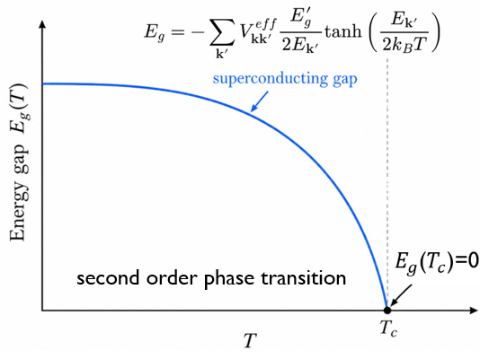

在BCS理論中,Cooper發現:

In the BCS theory, Cooper discovered that:

$$
若Fermi{}surface外有兩顆電子,位在r_{1}和r_{2},其相互作用為V(r_{1}-r_{2})並和自旋無關,且和Fermi{}surface內的電子無相互作用,那兩電子的Hamilition為:
$$

$$
If{}there{}are{}two{}electrons{}outside{}the{}Fermi{}surface,{}located{}at{}r_{1}{}and{}r_{2},{}their{}interaction{}is{}V(r_{1}-r_{2}),{}which{}is{}spin-independent{}and{}does{}not{}interact{}with{}the{}electrons{}inside{}the{}Fermi{}surface,{}the{}Hamiltonian{}of{}the{}two{}electrons{}is:
$$

$$
H=-\frac{1}{2m} (\frac{\partial^{2} }{\partial r_{1}^{2}} +\frac{\partial^{2} }{\partial r_{2}^{2}})+V(r_{1}-r_{2})
$$

$$
將電子座標換成質心座標(r_{1}+r_{2})/2和相對座標r=r_{1}-r_{2}:
$$

$$
Transform{}the{}electron{}coordinates{}to{}the{}center-of-mass{}coordinate{}(r_{1}+r_{2})/2{}and{}the{}relative{}coordinate{}r=r_{1}-r_{2}
$$

$$
\frac{\partial }{\partial r_{1}}=\frac{\partial  }{\partial R}\frac{\partial R }{\partial r_{1}}+\frac{\partial  }{\partial r}\frac{\partial r }{\partial r_{1}}=\frac{1}{2}\frac{\partial  }{\partial R}+\frac{\partial  }{\partial r}
$$

$$
\frac{\partial }{\partial r_{2}}=\frac{\partial  }{\partial R}\frac{\partial R }{\partial r_{2}}+\frac{\partial  }{\partial r}\frac{\partial r }{\partial r_{2}}=\frac{1}{2}\frac{\partial  }{\partial R}-\frac{\partial  }{\partial r} 
$$

Hamilition可改為:

The Hamilition can be transform that :

$$
H=-\frac{1}{2m} (\frac{\partial^{2} }{\partial r_{1}^{2}} +\frac{\partial^{2} }{\partial r_{2}^{2}})+V(r_{1}-r_{2})=-\frac{1}{4m} \frac{\partial^{2} }{\partial R^{2}}-\frac{1}{m} \frac{\partial^{2} }{\partial r^{2}}+V(r) 
$$

可發現質心運動和相對運動分離,而質心運動屬於自由運動,系統波函數和eigenfuction可寫成:

we can finds that the center-of-mass motion and the relative motion separate, and the center-of-mass motion is free; the system wavefunction and eigenfunction can be written as:

$$
\Psi (r_{1} ,r_{2})=\Psi (R ,r)=\frac{e^{iqR} }{\sqrt{N_{p} } } \psi (r);H\Psi (R ,r)=E\Psi (R ,r)
$$

Hamilition作用在波函數後,eigenfuction為:

After the Hamiltonian acts on the wavefunction, the eigenfunction is:

$$
[\frac{q^{2} }{4m} -2\frac{1}{2m} \frac{\partial^{2} }{\partial r^{2}}+V(r)]\psi (r)\Longrightarrow [-2\frac{1}{2m} \frac{\partial^{2} }{\partial r^{2}}+V(r)]\psi (r) =[E-\frac{q^{2} }{4m}]\psi (r)
$$

$$
兩個電子的總能為E=\frac{q^{2} }{4m} -2\frac{1}{2m} \frac{\partial^{2} }{\partial r^{2}}+V(r),接著對相對運動波函數和相互作用進行fouier{}trnsform:設兩個電子的動量分別為\vec{k}和\vec{k'},具有下列性質:
$$

$$
The{}total{}energy{}of{}the{}two{}electrons{}is{}E=\frac{q^{2}}{4m}{}-2\frac{1}{2m}{}\frac{\partial^{2}}{\partial{}r^{2}}+V(r),{}and{}next{}we{}use{}Fourier{}transform{}acts{}on{}the{}relative-motion{}wavefunction{}and{}the{}interaction.{}Let{}the{}momenta{}of{}the{}two{}electrons{}be{}\vec{k}{}and{}\vec{k'};{}they{}have{}the{}following{}properties:
$$

$$
|\vec{k}|= |\vec{k'}|,\Delta k=\vec{k'}-\vec{k}
$$

$$
\psi (r)=\frac{1}{\sqrt{N_{p} } } \sum_{k}^{} e^{ikr} \psi (k);V(r)=\sum_{\Delta k}^{} e^{i\Delta kr} V (\Delta k)
$$

Hamilition作用在相對運動波函數後,eigenfuction為:

After the Hamiltonian acts on the relative-motion wavefunction, the eigenfunction is:

$$
2\frac{k^{2} }{2m}\sum_{k}^{}\frac{e^{ikr} }{\sqrt{N_{p}} }\psi (k)+\sum_{k,\Delta k}^{} \frac{e^{i(k+\Delta k)r} }{\sqrt{N_{p}} }\psi (k)V( \Delta k) =[E-\frac{q^{2} }{4m}]\frac{1}{\sqrt{N_{p} } } \sum_{k}^{} e^{ikr} \psi (k)
$$

可改寫為:

It can be rewritten as:

$$  
\sum_{k}^{}[2\frac{k^{2}}{2m}-E+\frac{q^{2} }{4m}]\frac{e^{ikr} }{\sqrt{N_{p}} }\psi (k)+\sum_{k,k'}^{} \frac{e^{ik'r} }{\sqrt{N_{p}} }\psi (k')V( \vec{k'}-\vec{k}) =0
$$

接下來:

Next:

$$
\sum_{k}^{}[(2\frac{k^{2}}{2m}-E+\frac{q^{2} }{4m})\psi (k)+\sum_{k'}^{}V( \vec{k'}-\vec{k})\psi (k')]\frac{e^{ikr} }{\sqrt{N_{p}} } =0
$$

$$
設自由單電子的能量為\frac{k^{2} }{2m},Fermi{}surface的電子能量為E_{F},則相對於Fermi{}surface的單電子能量為\varepsilon _{k} = \frac{k^{2} }{2m} -E_{F} ,則式子變為:
$$

$$
Let{}the{}energy{}of{}a{}free{}single{}electron{}be{}\frac{k^{2}}{2m},{}and{}the{}energy{}of{}electrons{}on{}the{}Fermi{}surface{}be{}E_{F}.{}Then,{}the{}single-electron{}energy{}relative{}to{}the{}Fermi{}surface{}is{}\varepsilon _{k}{}={} \frac{k^{2}}{2m}{}-E_{F}{}and{}the{}expression{}becomes:
$$

$$
(2\varepsilon _{k}+2E_{F} -E+\frac{q^{2} }{4m})\psi (k)+\sum_{k'}^{}V( \vec{k'}-\vec{k})\psi (k') =0
$$

$$
假設在Fermi-surface附近上下一點的能量範圍(\omega_q)內,兩個電子間存在勢能:V_{kq}<0,表明其存在吸引相互作用:
$$

$$
Assume{}that{}within{}an{}energy{}range{}(\omega_q){}above{}and{}below{}the{}Fermi{}surface,{}there{}exists{}a{}potential{}between{}the{}two{}electrons:{}V_{kq}<0,{}indicating{}the{}presence{}of{}an{}attractive{}interaction:
$$

$$
V(\vec{k}' - \vec{k}) =
\begin{cases}
  -V_{kq}, & |\varepsilon_{k} - \varepsilon_{k'}| < \omega_q \\
  0, & \text{otherwise}
\end{cases}
$$

在此假設下,可得到:

Under this assumption, we can obtain:

$$
(2\varepsilon _{k}+2E_{F} -E+\frac{q^{2} }{4m})\psi (k)-V_{kq}\sum_{k'}^{}\psi (k') =0
$$

$$
\psi (k)=\frac{1}{(2\varepsilon _{k}+2E_{F} -E+\frac{q^{2} }{4m})} V_{kq}\sum_{k'}^{}\psi (k')
$$

對兩邊進行求和:

Perform a summation over both sides:

$$
\sum_{k}^{}\psi (k)=V_{kq}\sum_{k}^{}\frac{1}{(2\varepsilon _{k}+2E_{F} -E+\frac{q^{2} }{4m})} \sum_{k'}^{}\psi (k')
$$

$$
這時需考慮電子的自旋波函數的部分,因為當兩電子的自旋波函數為單重態:\frac{1}{\sqrt{2} } (\left | \uparrow \downarrow   \right \rangle -\left | \uparrow \downarrow  \right \rangle )時,因為兩電子的波函數具反對稱性,自旋波函數為單重態時,空間部分對稱性要求\psi (r)=\psi(-r),因此fouier{}trnsform時可發現:
$$

$$
At{}this{}point,{}one{}needs{}to{}consider{}the{}spin{}part{}of{}the{}electrons’{}wavefunction.{}When{}the{}two{}electrons{}form{}a{}singlet{}spin{}state:{}\frac{1}{\sqrt{2}}{}(\left|{}\uparrow\downarrow{}\right\rangle{}-{}\left|{}\uparrow\downarrow{}\right\rangle){}because{}the{}total{}wavefunction{}of{}the{}two{}electrons{}must{}be{}antisymmetric,{}the{}spatial{}part{}must{}be{}symmetric{}for{}a{}singlet{}spin{}state,{}i.e.,{}\psi(r){}={} \psi(-r).{}Therefore,{}upon{}performing{}a{}Fourier{}transform,{}we{}finds:
$$

$$
\frac{1}{\sqrt{N_{p} } } \sum_{k}^{} e^{ikr} \psi (k)=\frac{1}{\sqrt{N_{p} } } \sum_{k}^{} e^{-ikr} \psi (k);\frac{1}{\sqrt{N_{p} } } \sum_{k}^{} e^{ikr} \psi (k)=\frac{1}{\sqrt{N_{p} } } \sum_{k}^{} e^{ik''r} \psi (-k'')=>\psi (k)=\psi (-k)
$$

$$
同時因|\vec{k}|= |\vec{k'}|導致求和值不為零(無意義),且\sum_{k}^{}\psi (k)=\sum_{k'}^{}\psi (k'),所以式子可變為:
$$

$$
At{}the{}same{}time,{}since{}|\vec{k}|={}|\vec{k'}|,{}a{}direct{}summation{}would{}yield{}zero{}(which{}is{}meaningless),{}and{}moreover{}\sum_{k}^{}\psi(k)={} \sum_{k'}^{}\psi(k').{}Therefore,{}the{}expression{}can{}be{}rewritten{}as:
$$

$$
1=V_{kq}\sum_{k}^{}\frac{1}{(2\varepsilon _{k}+2E_{F} -E+\frac{q^{2} }{4m})}
$$

$$
求和化積,其積分至電子在費米面的能量薄層\omega _{c}:
$$

$$
Replace{}the{}summation{}with{}an{}integral,{}with{}the{}integration{}taken{}over{}an{}energy{}shell{} \omega _{c}{}around{}the{}Fermi{}surface:
$$

$$
1=V_{kq}\int_{0}^{\omega _{c} } \frac{d\varepsilon _{k}}{(2\varepsilon _{k}+2E_{F} -E+\frac{q^{2} }{4m})}\Longrightarrow 1=\frac{V_{kq}}{2}[ln(2\omega _{q}+2E_{F} -E+\frac{q^{2} }{4m})-ln(2E_{F} -E+\frac{q^{2} }{4m})  ]
$$

可以得到:

We then obtains:

$$
e^{\frac{2}{V_{kq} } } =\frac{2\omega _{c}+2E_{F} -E+\frac{q^{2} }{4m}}{2E_{F} -E+\frac{q^{2} }{4m}} \Longrightarrow E=2E_{F} +\frac{q^{2} }{4m}-(2\omega _{c} +2E_{F} -E+\frac{q^{2} }{4m})e^{-\frac{2}{V_{kq} } }
$$

$$
在弱耦和極限下,V_{kq}<<1,此時E\simeq 2E_{F} +\frac{q^{2} }{4m},所以兩個電子的eigenvalue為:
$$

$$
In{}the{}weak-coupling{}limit,,{}V_{kq}<<1,{}we{}have{}E\simeq{}2E_{F}{}+{}\frac{q^{2}}{4m}.{}Therefore,{}the{}eigenvalue{}of{}the{}two{}electrons{}is:
$$

$$
E\approx 2E_{F} +\frac{q^{2} }{4m}-2\omega _{c} e^{-\frac{2}{V_{kq} } }
$$

可以看到若兩個電子的質心動能=0時,兩個電子的eigenvalue便小於兩電子自由時的energy,因此會產生束縛態,而這個系統的最低能量為:

We can see if the center-of-mass kinetic energy of the two electrons is zero, the eigenvalue of the two electrons is lower than the energy of two free electrons, thus a bound state forms. The minimum energy of this system is:

$$
E_{min}=  2E_{F}-2\omega _{c} e^{-\frac{2}{V_{kq} } }<2E_{F}
$$

這證明了,只要有吸引力存在,自旋相反的電子會形成總自旋為0的自旋單重態,動量相反的兩個電子會形成配對使系統能量降低,這就是cooper pair,也是超導態的起源;當形成cooper pair後,cooper pair會彼此長相干,讓彼此形成一致相位(行動一致),此時材料自發對稱破缺,形成宏觀量子相干凝聚態,具有零電阻,麥斯納效應等現象,材料正式進入超導態.

This demonstrates that, as long as an attractive interaction exists, electrons with opposite spins can form a spin-singlet state with total spin zero. Two electrons with opposite momenta can pair up, lowering the total energy of the system—this is the Cooper pair, which is the origin of superconductivity. Once Cooper pairs are formed, they develop long-range phase coherence, establishing a unified macroscopic phase. At this point, spontaneous symmetry breaking occurs, leading to a macroscopic quantum coherent condensate characterized by zero electrical resistance and the Meissner effect. The material then formally enters the superconducting state.

所以怎麼從庫柏對到超導轉變溫度呢?

Why can from Cooper Pairs to the Superconducting Transition Temperature ?

1. Spin-Singlet Cooper Pair（自旋單重態庫柏對）

電子是費米子，因此交換兩個電子時，總波函數必須具有反對稱性：

Electrons are fermions. Therefore, the total wave function must change sign when we exchange two electrons:

$$
\Psi_{\mathrm{total}}(1,2)=-\Psi_{\mathrm{total}}(2,1)
$$

總波函數可以分成空間波函數與自旋波函數：

The total wave function has two parts: the spatial wave function and the spin wave function.

$$
\Psi_{\mathrm{total}}=\Psi_{\mathrm{orbital}}\chi_{\mathrm{spin}}
$$

在傳統的各向同性 s 波配對中，空間波函數具有對稱性：

For conventional s-wave pairing, the spatial wave function is symmetric:

$$
\Psi_{\mathrm{orbital}}(1,2)=\Psi_{\mathrm{orbital}}(2,1)
$$

因此，為了滿足總波函數的反對稱性，自旋波函數必須具有反對稱性：

Therefore, the spin wave function must be antisymmetric:

$$
\chi_{\mathrm{spin}}(1,2)=-\chi_{\mathrm{spin}}(2,1)
$$

所以兩個電子可以形成自旋單重態，其總自旋為零：

Thus, two electrons can form a spin-singlet state with total spin zero:

$$
\chi_{\mathrm{singlet}}=\frac{1}{\sqrt{2}}\left(|\uparrow\downarrow\rangle-|\downarrow\uparrow\rangle\right)
$$

$$
S=0
$$

在傳統 BCS 模型中，兩個電子通常具有相反的動量與相反的自旋，形成庫柏對：

In the conventional BCS model, two electrons usually have opposite momenta and opposite spins. They form a Cooper pair:

$$
(\mathbf{k},\uparrow),\quad(-\mathbf{k},\downarrow)
$$

這是傳統自旋單重態配對的物理圖像。

This is the physical picture of conventional spin-singlet pairing.

2. Superconducting Gap and Transition Temperature（超導能隙與臨界溫度）

當大量電子形成具有相干性的庫柏對時，系統進入超導態，並出現超導能隙參數 \(\Delta\)。

When many Cooper pairs have the same macroscopic phase, the system becomes superconducting. A superconducting gap parameter \(\Delta\) appears.

在 BCS 理論中，電子的準粒子激發能量為：

In BCS theory, the quasiparticle energy is:

$$
E_{\mathbf{k}}=
\sqrt{\xi_{\mathbf{k}}^2+|\Delta|^2}
$$

其中：

- $\xi_{\mathbf{k}}=\varepsilon_{\mathbf{k}}-\varepsilon_F$：電子能量相對於費米能階的差值。
- $\Delta$：超導能隙參數。
- $E_{\mathbf{k}}$：超導態的準粒子激發能量。

Where:

- $\xi_{\mathbf{k}}=\varepsilon_{\mathbf{k}}-\varepsilon_F$: The electron energy measured from the Fermi level.
- $\Delta$: The superconducting gap parameter.
- $E_{\mathbf{k}}$: The quasiparticle energy in the superconducting state.

在平均場 BCS 理論中，超導能隙滿足自洽方程：

In BCS mean-field theory, the superconducting gap follows a self-consistent equation:

$$
\Delta_{\mathbf{k}}=-\sum_{\mathbf{k}'}V_{\mathbf{k}\mathbf{k}'}^{\mathrm{eff}}\frac{\Delta_{\mathbf{k}'}}{2E_{\mathbf{k}'}}\tanh\left(\frac{E_{\mathbf{k}'}}{2k_BT}\right)
$$

從這個方程可以發現，超導能隙會隨溫度改變。

From this equation, we can see that the superconducting gap changes with temperature.

當溫度上升時，超導能隙逐漸減小；當溫度達到臨界溫度 \(T_c\) 時，超導能隙參數變成零：

When the temperature increases, the superconducting gap becomes smaller. At the transition temperature \(T_c\), the gap parameter becomes zero:

$$
\boxed{
\Delta(T_c)=0
}
$$

在傳統 BCS 平均場理論中，這對應連續的二階超導相變。

In conventional BCS mean-field theory, this is a continuous second-order phase transition.

3. From the BCS Gap Equation to the Transition Temperature（從能隙方程到超導臨界溫度）

在簡化的 BCS 模型中，假設費米能階附近的電子態密度近似為常數，且電子之間存在固定的有效吸引作用。

In the simple BCS model, we assume that the density of states near the Fermi level is nearly constant. We also assume a constant attractive interaction between electrons.

當溫度接近超導臨界溫度時：

When the temperature approaches the transition temperature:

$$
T\rightarrow T_c,\qquad \Delta\rightarrow0
$$

因此，BCS 能隙方程可以簡化為：

Therefore, the BCS gap equation becomes:

$$
\boxed{
1=
N(0)V
\int_0^{\hbar\omega_D}
\frac{\tanh\left(\frac{\xi}{2k_BT_c}\right)}{\xi}
\,d\xi
}
$$

其中：

- $N(0)$：費米能階的單自旋電子態密度。
- $V>0$：有效吸引相互作用的強度。
- $\omega_D$：德拜頻率。
- $T_c$)：超導臨界溫度。

Where:

- $N(0)$: The electronic density of states per spin at the Fermi level.
- $V>0$): The strength of the attractive interaction.
- $\omega_D$: The Debye frequency.
- $T_c$: The superconducting transition temperature.

在弱耦合極限下，求解這個方程，可以得到：

In the weak-coupling limit, solving this equation gives:

$$
\boxed{
k_BT_c
\simeq
1.14\,\hbar\omega_D
\exp\left[
-\frac{1}{N(0)V}
\right]
}
$$

從這個公式可以看出，超導臨界溫度主要受到電子態密度、有效吸引作用強度及聲子能量尺度的影響。

This equation shows that the transition temperature depends on the electronic density of states, the attractive interaction strength, and the phonon energy scale.

當有效配對作用越強時，超導臨界溫度通常越高。

A stronger attractive pairing interaction usually gives a higher transition temperature.

4. From BCS Theory to the McMillan–Allen–Dynes Equation（從 BCS 理論到麥克米蘭－艾倫－戴恩斯公式）

前面的 BCS 模型使用固定的有效吸引作用與簡化的聲子能量截止值。

The simple BCS model uses a constant attractive interaction and a simple phonon energy cutoff.

但在真實材料中，電子－聲子相互作用與聲子頻率有關，因此需要更完整的理論來描述超導配對。

In real materials, the electron–phonon interaction depends on the phonon frequency. Therefore, we need a more detailed theory to describe superconducting pairing.

Migdal–Eliashberg Theory（米格達爾－艾利亞什伯格理論）

BCS 理論使用簡化的有效吸引作用來描述電子配對，但沒有明確考慮電子－聲子相互作用隨頻率變化的細節。

BCS theory uses a simple attractive interaction to describe electron pairing. However, it does not directly describe how the electron–phonon interaction changes with frequency.

米格達爾－艾利亞什伯格理論進一步延伸 BCS 理論，將電子－聲子相互作用的頻率依賴性納入超導配對的計算。

Migdal–Eliashberg theory extends BCS theory by including the frequency dependence of the electron–phonon interaction.

此外，這個理論也考慮電子因電子－聲子相互作用而產生的自能效應，進而影響電子的有效質量與超導配對性質。

It also includes electron self-energy effects caused by the electron–phonon interaction. These effects can change the effective electron mass and superconducting pairing.

因此，相較於簡化的 BCS 模型，米格達爾－艾利亞什伯格理論可以更詳細地描述真實材料中的聲子媒介超導現象。

Therefore, Migdal–Eliashberg theory can describe phonon-mediated superconductivity in more detail than the simple BCS model.

我們使用這些近似:

We use this approximations:

4-1. Phonon-Mediated Pairing（聲子媒介配對）

在傳統超導理論中，我們假設電子之間的有效吸引作用主要來自聲子交換，因此超導配對主要由電子－聲子相互作用產生。

In conventional superconductivity, we assume that electrons mainly form Cooper pairs by exchanging phonons. The electron–phonon interaction provides the attractive interaction.

4-2. Migdal Approximation（米格達爾近似）

在一般金屬中，聲子的特徵能量通常遠小於電子的特徵能量：

In most metals, phonon energies are much smaller than the characteristic electron energy:

$$
\hbar\omega_{\mathrm{ph}}\ll E_F
$$

因此，當相關的小參數足夠小時，我們可以忽略高階的電子－聲子頂角修正，以簡化電子－聲子相互作用的計算。

Therefore, when the relevant small parameter is small enough, we can ignore higher-order electron–phonon vertex corrections. This makes the calculation easier.

需要注意，這個近似是否可靠，也與電子－聲子耦合強度有關。

However, this approximation also depends on the electron–phonon coupling strength.

4-3. Fermi-Surface Averaging（費米面平均近似）

在真實材料中，電子－聲子耦合強度會隨電子動量、聲子動量和電子能帶而改變。

In real materials, the electron–phonon coupling depends on electron momentum, phonon momentum, and electronic bands.

為了簡化計算，我們將費米面上不同電子態的電子－聲子耦合貢獻進行平均，並使用平均後的電子－聲子譜函數描述配對作用。

To make the calculation easier, we average the electron–phonon coupling over the Fermi surface. We then use an averaged electron–phonon spectral function.

這個近似可以減少計算的複雜性，但也會失去費米面不同區域之間的耦合差異。

This makes the calculation simpler, but we lose information about differences between parts of the Fermi surface.

4-4. Coulomb Pseudopotential（庫侖贗勢近似）

電子之間存在庫侖排斥作用，但由於電子屏蔽與遲滯效應，低能配對問題中的有效庫侖排斥可以減弱。

Electrons repel each other, but screening and the retardation effect can reduce the effective Coulomb repulsion in the pairing problem.

因此，我們使用庫侖贗勢參數 ($\mu^*$) 來描述低能配對問題中的有效庫侖排斥作用。

Therefore, we use the Coulomb pseudopotential ($\mu^*$) to describe the effective Coulomb repulsion.

在簡化的各向同性模型中，我們通常將 ($\mu^*$) 視為固定參數，以避免直接計算完整的庫侖相互作用。

In a simple isotropic model, we usually treat ($\mu^*$) as a fixed parameter. This makes the calculation easier.

4-5. Isotropic s-Wave Approximation（各向同性 s 波配對近似）

在傳統各向同性 s 波超導模型中，我們假設超導能隙在費米面不同位置上近似相同：

In the isotropic s-wave model, we assume that the superconducting gap is nearly the same everywhere on the Fermi surface:

$$
\Delta(\mathbf{k},T)\approx\Delta(T)
$$

因此，我們不需要分別計算不同動量位置的超導能隙，可以大幅簡化超導能隙方程。

Therefore, we do not need to calculate a different gap for every momentum. This makes the gap equation much simpler.

但這個近似無法準確描述超導能隙具有明顯動量依賴性的材料。

However, this approximation cannot accurately describe materials where the superconducting gap changes strongly with momentum.

需要注意，s 波描述配對的對稱性，而各向同性描述超導能隙在費米面上的變化程度，兩者並不完全相同。

Note that s-wave describes the pairing symmetry, while isotropic means that the gap is nearly the same everywhere on the Fermi surface.

在常用的各向同性近似下，麥克米蘭－艾倫－戴恩斯公式可以用電子－聲子耦合參數及聲子頻譜的特徵頻率，估算超導臨界溫度：

For many conventional superconductors, the McMillan–Allen–Dynes equation can estimate the transition temperature using the electron–phonon coupling strength and the phonon spectrum:

$$
\boxed{
T_c=
\frac{\omega_{\log}}{1.2}
\exp\left[
-\frac{1.04(1+\lambda)}
{\lambda-\mu^*(1+0.62\lambda)}
\right]
}
$$

此處 $\omega_{\log}$ 以溫度單位表示。

Here, $\omega_{\log}$ is expressed in temperature units.

其中：

- $\lambda$)：電子－聲子耦合強度。
- $\omega_{\log}$：聲子頻率的對數平均值。
- $\mu^*$：庫侖贗勢參數。
- $T_c$：超導臨界溫度。

Where:

- $\lambda$: The electron–phonon coupling strength.
- $\omega_{\log}$: The logarithmic average phonon frequency.
- $\mu^*$: The Coulomb pseudopotential.
- $T_c$: The superconducting transition temperature.

這個公式說明超導臨界溫度不只受到電子－聲子吸引作用影響，也與聲子頻譜及有效庫侖排斥有關。

This equation shows that the transition temperature depends on the electron–phonon attraction, the phonon spectrum, and the effective Coulomb repulsion.

因此，在第一原理超導計算中，我們可以使用密度泛函微擾理論計算聲子與電子－聲子耦合，再估算材料的超導臨界溫度。

Therefore, in first-principles calculations, we can use density functional perturbation theory to calculate phonons and electron–phonon coupling. We can then estimate the superconducting transition temperature.
